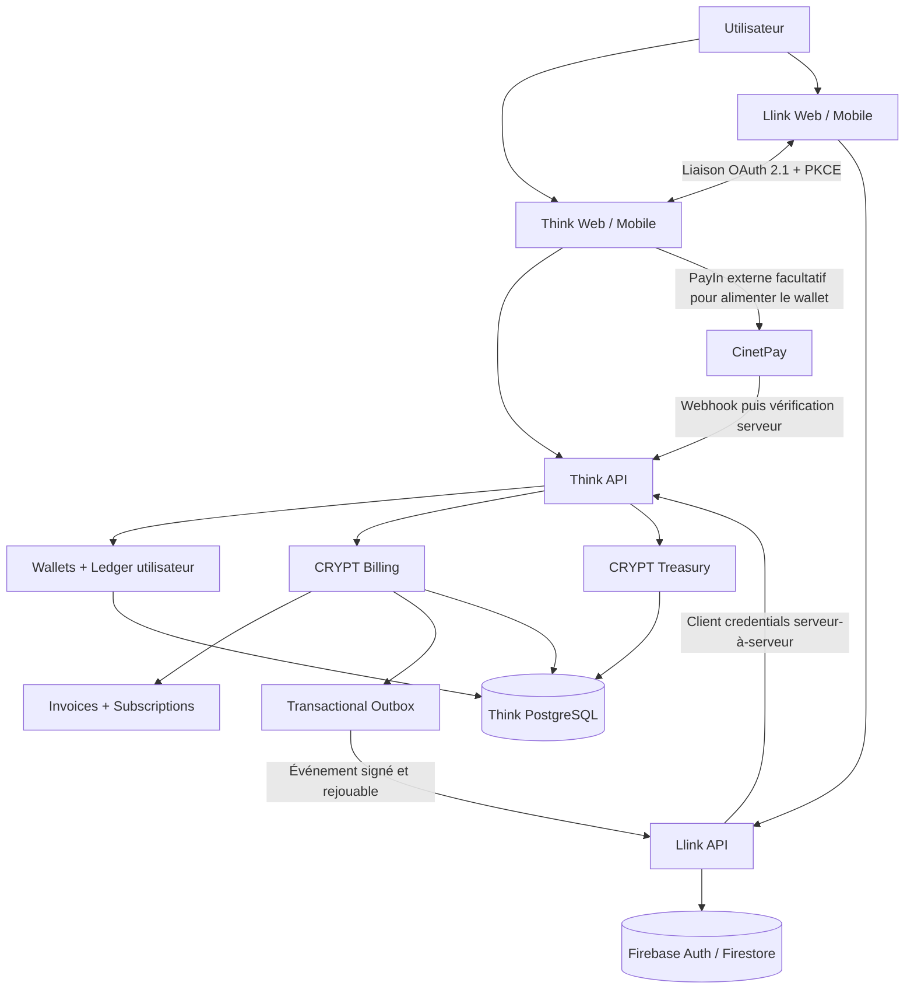

# CRYPT Billing & Treasury — Architecture cible

**Statut :** spécification d'architecture, pas encore une implémentation fonctionnelle.  
**Dépôt :** `think-crypt-entre`  
**Branche documentaire :** `crypt-billing-architecture`  
**Décisions validées par le propriétaire :**
- Les comptes Think et Llink restent distincts et peuvent être liés à la demande de l'utilisateur.
- Les abonnements Think et Llink sont payés avec le portefeuille Think.
- Les recettes commerciales Think et Llink alimentent une trésorerie CRYPT commune, tout en conservant une ventilation comptable par produit.

## 1. Objectifs et principes non négociables

CRYPT Billing & Treasury fournit un parcours commercial commun aux produits CRYPT sans fusionner leurs systèmes d'identité ni leurs bases de données.

1. **Think est l'autorité financière utilisateur** : authentification Think, portefeuilles, débit du portefeuille, paiements CinetPay PayIn et journal utilisateur.
2. **Billing est l'autorité des commandes et abonnements** : catalogue, prix, factures, états des abonnements et événements de droits.
3. **Treasury est le registre comptable de CRYPT** : encaissements, dettes envers les utilisateurs, revenus différés, revenus acquis, frais, remboursements, rapprochement et ventilation par produit.
4. **Llink conserve Firebase Auth et Firestore** pour ses comptes et son expérience IA. Il ne décide jamais qu'un paiement est réussi.
5. **La trésorerie est commune, les dimensions analytiques ne le sont pas** : chaque écriture commerciale garde obligatoirement `product_code` (`think`, `llink`, puis autres produits).
6. Les soldes de portefeuille des clients sont des **fonds dus aux utilisateurs**, pas des revenus de CRYPT.
7. Aucun prix, taux de change, frais, droit ou statut de paiement transmis par un navigateur n'est accepté comme vérité.
8. Les événements financiers sont idempotents, auditables et atomiques autant que possible.
9. Aucune opération PayOut réelle n'est activée par cette spécification. Le PayOut reste séparé des abonnements et du chiffre d'affaires.

## 2. Architecture logique

MVP recommandé : conserver le cœur Billing & Treasury dans le backend Think/FastAPI et dans sa base PostgreSQL dédiée. Ne pas lancer immédiatement un troisième microservice ou une troisième base à maintenir. Les modules doivent cependant être séparés dans le code pour pouvoir être extraits plus tard.

**Règle de paiement demandée :** un abonnement Llink n'est pas payé directement sur CinetPay. Le client paie d'abord le solde de son portefeuille Think (éventuellement via CinetPay PayIn), puis Think débite ce portefeuille pour régler la facture d'abonnement. En l'absence de fonds suffisants, la facture reste impayée.

## 3. Responsabilités par système

| Système | Autorité / responsabilité | Ne doit pas faire |
|---|---|---|
| Think Auth | Identité du compte Think et session Think | Se faire passer pour l'identité Firebase |
| Firebase Auth | Identité du compte Llink | Décider du débit Think |
| Account Linking | Associer les deux identifiants après consentement | Fusionner les comptes ou partager les mots de passe |
| Billing | Tarifs, factures, abonnements, renouvellements | Modifier directement le solde utilisateur |
| Wallet | Débit/crédit du portefeuille Think avec verrou transactionnel | Comptabiliser un dépôt de client comme chiffre d'affaires |
| CinetPay PayIn | Confirmer un approvisionnement externe | Activer seul un abonnement |
| Treasury | Écritures comptables et états de rapprochement | Déduire une recette d'une simple redirection navigateur |
| Llink Entitlements | Répliquer les droits confirmés de Llink | Accepter un ordre de mise à niveau envoyé par le frontend |

## 4. Liaison facultative des comptes

### 4.1 Modèle

Créer dans PostgreSQL une table `account_links` :

- `id` UUID/identifiant interne ;
- `think_user_id` FK vers `think_users.id`, unique pour une liaison active ;
- `llink_firebase_uid` chaîne, unique pour une liaison active ;
- `status` : `pending`, `active`, `revoked`, `needs_review` ;
- `think_verified_at`, `llink_verified_at`, `linked_at`, `revoked_at` ;
- `consent_version`, `consent_text_hash`, `created_at`, `updated_at`.

Ne jamais stocker un mot de passe Think, un Firebase refresh token ou un ID token Firebase dans cette table.

### 4.2 Parcours sécurisé recommandé

1. L'utilisateur est déjà connecté à Llink. Le backend Llink vérifie le Firebase ID token et crée une session de liaison aléatoire, courte (5 à 10 minutes), à usage unique.
2. Llink redirige l'utilisateur vers l'autorisation Think avec `state`, `nonce`, `code_challenge` PKCE et une URI de retour strictement allowlistée.
3. Think authentifie l'utilisateur Think, exige une confirmation explicite « Lier mon compte Llink à ce compte Think » et une réauthentification récente si la session est ancienne.
4. Think délivre un code d'autorisation à usage unique, à durée courte, lié au client Llink, à l'URI de retour et au challenge PKCE.
5. Le backend Llink échange le code en serveur-à-serveur, valide le résultat et relie le `think_user_id` reçu au Firebase UID conservé dans la session Llink initiale. Le Firebase UID ne vient jamais d'un champ libre soumis par le navigateur.
6. Les deux produits affichent la liaison et permettent sa révocation. La révocation empêche les prochains achats et événements, mais ne supprime pas les factures historiques.

Pour le MVP, implémenter un flux OAuth 2.1 Authorization Code + PKCE et un client confidentiel Llink (authentification serveur). Ne pas inventer un pseudo-OAuth basé sur un simple `user_id` envoyé par le frontend.

### 4.3 Routes de liaison proposées

Côté Think :
- `GET /oauth/authorize` : login/consentement et émission du code.
- `POST /oauth/token` : échange du code, vérification PKCE et authentification du client.
- `GET /api/v1/identity/me` : identité minimale autorisée pour le compte Think.

Côté Llink :
- `POST /api/account-links/think/start` : session de liaison pour l'utilisateur Firebase authentifié.
- `GET /api/account-links/think/callback` : validation de state et échange du code côté serveur.
- `GET /api/account-links` : état de la liaison du compte courant.
- `DELETE /api/account-links/think` : révocation après confirmation.

Protection : state anti-CSRF, nonce, PKCE S256, code à usage unique, expiration courte, redirect URI exacte, rate limiting, journal d'audit, reauthentification pour changement/révocation et interdiction de lier un même Think ID à plusieurs UID Firebase (et inversement) sans processus explicite de récupération.

## 5. Catalogue, factures et abonnements

### 5.1 Catalogue central

Le frontend ne fixe jamais le prix. Billing expose un catalogue actif :

- `product_code` : `think`, `llink` ;
- `plan_code` : code stable (ex. `standard`, `premium`, `bronze`, `silver`, `gold`, `diamant`) ;
- `sku` unique ;
- `billing_period` : `month`, `year`, `one_time` ;
- `amount_minor` en unité mineure entière (jamais float) ;
- `currency` ISO 4217 ;
- `active`, `effective_from`, `effective_until`, `version`.

Les prix existants de Think sont aujourd'hui définis en EUR alors que le portefeuille PayIn RDC et CinetPay sont configurés en CDF. Avant de lancer le paiement par portefeuille pour le marché RDC, définir explicitement un prix CDF par SKU ou une vraie politique de conversion validée. **Ne pas convertir silencieusement EUR vers CDF et ne pas inventer un taux de change.** Le MVP peut démarrer avec un seul prix CDF par plan pour la RDC. Les rapports multidevises ne doivent jamais additionner CDF, USD et EUR comme s'il s'agissait de la même monnaie.

### 5.2 Modèle SQL cible

Créer progressivement les tables ci-dessous. Les noms peuvent être adaptés aux conventions SQLAlchemy existantes, mais les contraintes uniques et les relations doivent être conservées.

| Table | Champs importants |
|---|---|
| `account_links` | think_user_id, llink_firebase_uid, status, consent timestamps |
| `billing_products` | code unique, name, active |
| `billing_prices` | product_code, plan_code, SKU, amount_minor, currency, period, version |
| `billing_invoices` | public_id, payer_user_id, product_code, plan_code, amount_minor, currency, status, idempotency_key, due_at, paid_at |
| `billing_invoice_lines` | invoice_id, description, quantity, unit_amount_minor, tax metadata éventuelle |
| `billing_payments` | invoice_id, wallet_id, payment_method=think_wallet, amount_minor, status, idempotency_key, wallet_ledger_reference |
| `billing_subscriptions` | account_link_id nullable, payer_user_id, beneficiary_product, beneficiary_subject_id, plan_code, status, period_start, period_end, auto_renew |
| `billing_events_outbox` | event_id unique, aggregate_id, event_type, payload JSON, created_at, published_at, attempts, last_error |
| `treasury_accounts` | account_code, account_name, account_type, currency, active |
| `treasury_journals` | journal_id, source_reference unique, event_type, effective_at, status, description |
| `treasury_lines` | journal_id, account_code, debit_minor, credit_minor, currency, product_code nullable, reference, metadata |
| `treasury_adjustments` | journal_id original, reason, created_by, approved_by (si séparation des rôles) |

Toutes les sommes sont des entiers en unité mineure (ou Decimal maîtrisé au niveau ORM). Utiliser une seule convention documentée : pour CDF, une unité entière ; pour les monnaies à sous-unités, appliquer leur exposant ISO. Un journal doit s'équilibrer par devise : somme débits = somme crédits. Une écriture postée est immuable ; correction par écriture inverse/contrepassation, jamais par édition ou suppression.

### 5.3 Compatibilité avec les modèles existants

Think a déjà `ThinkUser`, `Wallet`, `LedgerEntry`, `PaymentTransaction` et `Subscription`. Réutiliser ces entités pour les opérations existantes, sans casser les routes frontend.

- `PaymentTransaction` reste le registre des PayIn externes CinetPay.
- `LedgerEntry` reste le registre du portefeuille de chaque utilisateur.
- `Subscription` est migrée progressivement vers une souscription portant explicitement `product_code` et `beneficiary_subject_id`. Les anciennes lignes sont migrées avec `product_code='think'` lorsque leur sens est certain ; les cas ambigus sont mis en revue.
- Les tables Treasury sont le grand livre de l'entreprise, distinct du ledger des portefeuilles clients.

Ajouter des migrations Alembic ou un système de migrations versionnées avant d'ajouter des colonnes/tables en production. `Base.metadata.create_all` ne remplace pas une migration de schéma.

## 6. Paiement d'un abonnement depuis le portefeuille Think

### 6.1 Création de facture

Llink appelle Think Billing via son backend, après authentification de l'utilisateur Llink et vérification de la liaison active. Think détermine le plan, le prix, la devise et le bénéficiaire depuis le catalogue et la liaison ; il ignore les prix transmis par Llink.

Routes internes proposées :
- `GET /api/v1/billing/catalog?product_code=llink`
- `POST /api/v1/billing/invoices` : demande de facture pour un SKU autorisé.
- `POST /api/v1/billing/invoices/{invoice_id}/pay-with-wallet` : débit Think atomique.
- `GET /api/v1/billing/invoices/{invoice_id}` : lecture limitée au payeur et au produit autorisé.
- `GET /api/v1/billing/subscriptions?product_code=llink` : état de l'abonnement lié.

### 6.2 Transaction atomique de débit

Dans une seule transaction PostgreSQL :
1. Verrouiller la facture `FOR UPDATE`, vérifier propriétaire, statut `open`, expiration et idempotency key.
2. Vérifier que la liaison Think/Llink est toujours `active` et que la souscription bénéficie bien au UID Firebase lié.
3. Lire le prix depuis l'enregistrement catalogue versionné ; vérifier devise et SKU.
4. Verrouiller le portefeuille Think correspondant `FOR UPDATE`.
5. Vérifier le solde disponible suffisant.
6. Débiter `available_balance`, créer le `LedgerEntry` de débit avec une référence unique, marquer la facture payée, créer le paiement et la souscription ou son renouvellement.
7. Créer le journal Treasury et l'événement Outbox dans la même transaction.
8. Commit. Si une étape échoue, tout est annulé.

Ne pas appeler Firestore ou un réseau externe à l'intérieur de cette transaction SQL. L'outbox transmettra l'événement après commit. Les répétitions de requêtes retournent le résultat déjà créé et ne débitent pas deux fois.

### 6.3 Échec de solde

Si le solde est insuffisant :
- aucun débit ;
- facture `open` ou `payment_failed` selon le modèle retenu ;
- réponse `409 INSUFFICIENT_WALLET_BALANCE` avec montant manquant et devise ;
- lien vers l'écran de recharge du portefeuille Think (CinetPay PayIn Sandbox reste un parcours séparé).

### 6.4 Activation de Llink

Après commit, Outbox émet `subscription.activated` ou `subscription.renewed`. Llink consomme l'événement de façon idempotente, vérifie sa signature et met à jour les champs d'entitlement Firestore attendus par Llink (`isPro`, `expirationDate`, `subscriptionPlan`) en utilisant le mapping central SKU → plan Llink. Llink stocke le `event_id` traité pour ne pas appliquer deux fois un événement.

Si Firestore est indisponible, l'événement reste à réessayer. Le paiement reste acquitté côté Think ; Billing affiche « payé, activation en attente » jusqu'à accusé de réception Llink. Prévoir une route de resynchronisation administrative et une vérification périodique des droits.

## 7. Trésorerie commune avec analytique par produit

### 7.1 Trois registres distincts

1. **Wallet ledger utilisateur** : argent appartenant aux utilisateurs / dette Think envers les utilisateurs.
2. **Treasury journal CRYPT** : actifs, clearing, frais, revenus différés et revenus acquis de l'entreprise.
3. **Product analytics** : agrégats par `product_code` calculés depuis les lignes Treasury postées, pas à partir des clics ou abonnements simplement créés.

### 7.2 Comptes comptables de base

Les codes précis sont à faire valider par un comptable, mais le modèle logique peut commencer avec :

| Code illustratif | Compte |
|---|---|
| 1010 | CinetPay clearing / fonds en cours de règlement |
| 1020 | Banque / trésorerie disponible |
| 2010 | Passif — soldes des portefeuilles clients |
| 2020 | Passif — revenus d'abonnements différés |
| 4010 | Produit des abonnements Think |
| 4020 | Produit des abonnements Llink |
| 4090 | Ajustements / remboursements de revenus |
| 5010 | Frais prestataires de paiement |
| 5020 | Coûts fournisseurs IA et exploitation |

Ces comptes sont une structure technique indicative, pas un plan comptable légal RDC certifié. Les obligations fiscales, taxes, reconnaissance des revenus, devises de reporting et documents requis doivent être validés par un professionnel compétent.

### 7.3 Écritures types

**A. Un client alimente son portefeuille de 10 000 CDF par CinetPay** (paiement externe réellement confirmé ; frais illustratifs omis ici) :

- Débit 1010 CinetPay clearing : 10 000 CDF
- Crédit 2010 Passif soldes utilisateurs : 10 000 CDF

Ce n'est pas un revenu CRYPT.

**B. Un utilisateur paie un abonnement Llink de 3 000 CDF depuis son wallet** :

- Débit 2010 Passif soldes utilisateurs : 3 000 CDF
- Crédit 2020 Revenus abonnements différés : 3 000 CDF, `product_code=llink`

Le wallet diminue et la trésorerie analytique enregistre le produit prépayé ; le cash de CRYPT n'augmente pas une deuxième fois.

**C. Le service Llink est fourni sur la période** :

- Débit 2020 Revenus abonnements différés : part acquise
- Crédit 4020 Produit abonnements Llink : même montant, `product_code=llink`

Pour des abonnements prépayés, le calendrier de reconnaissance doit être défini (au fil de la période, ou selon la politique comptable applicable), et non comptabilisé deux fois au paiement et à la consommation.

**D. Remboursement** : générer des écritures inverses référencées à l'opération d'origine ; vérifier si le montant est retourné au wallet utilisateur ou via le canal fournisseur. Ne jamais effacer l'opération d'origine.

### 7.4 Trésorerie commune et rapports par source

Toutes les lignes utilisent le même ensemble d'entités de trésorerie CRYPT, mais portent les dimensions :
- `product_code` : think / llink ;
- `revenue_category` : subscription / service_fee / license / other ;
- `channel` : think_wallet / cinetpay / manual_adjustment ;
- `currency` ;
- `status` et `effective_at`.

Les tableaux de bord doivent montrer séparément :
- total encaissé (cash/clearing) ;
- passif des portefeuilles clients ;
- revenus différés ;
- revenus acquis ;
- frais CinetPay ;
- remboursements ;
- coûts IA / exploitation ;
- résultat net estimé ;
- ventilation par produit et par devise.

Ne pas additionner directement des montants de devises différentes. Toute vue convertie doit afficher le taux, la source, la date et la devise de référence.

## 8. API interne et événements

### 8.1 Authentification interservices

Llink appelle Think avec un client technique confidentiel. Recommandation : JWT client assertion signé par clé privée (RS256/EdDSA), courte durée (≤ 5 minutes), `iss`, `sub`, `aud`, `iat`, `exp`, `jti`, scopes minimaux et rotation de clé. TLS obligatoire. Une clé différente par environnement. Si une signature asymétrique n'est pas prête, secret partagé à haute entropie stocké uniquement côté serveur, rotation possible et signature HMAC du corps avec timestamp et anti-rejeu comme transition, pas une clé dans le frontend.

### 8.2 Événements

Événements versionnés et signés :
- `billing.invoice.paid.v1`
- `subscription.activated.v1`
- `subscription.renewed.v1`
- `subscription.expiring.v1`
- `subscription.expired.v1`
- `subscription.cancelled.v1`
- `subscription.refunded.v1`
- `account_link.revoked.v1`

Payload minimal : `event_id`, `event_type`, `occurred_at`, `product_code`, `subject_id` (Firebase UID), `subscription_id`, `invoice_id`, `plan_code`, `period_start`, `period_end`, `currency`, `amount_minor`, `schema_version`. Ne jamais y mettre email/numéro/clé secrète sauf nécessité strictement justifiée.

Chaque consommateur dispose d'une table de déduplication `processed_billing_events` avec `event_id UNIQUE`. Réessais exponentiels, DLQ/erreurs consultables, endpoint de replay protégé.

## 9. Renouvellements et cycle de vie

Décision MVP conseillée :
- abonnements achetés par wallet ;
- renouvellement automatique désactivé par défaut ;
- option d'activation séparée après consentement ;
- si autorisé, le job tente le débit wallet à la date prévue et ne passe jamais en négatif ;
- solde insuffisant : notification et période de grâce configurable, puis expiration des droits ;
- annulation arrête le renouvellement, pas la période déjà payée ;
- remboursement est une opération distincte et auditée ;
- aucun prélèvement récurrent de CinetPay en arrière-plan sans produit/mandat documenté et autorisé.

Le calendrier d'expiration Llink doit être piloté par l'abonnement Billing confirmé, puis répliqué vers Firestore. Les essais gratuits existants dans `/api/user/status` doivent rester compatibles et ne pas être écrasés par une facture échouée.

## 10. Protection des données et abus

- Une liaison ne peut être créée qu'après authentification des deux comptes et double consentement.
- Ne pas fusionner les emails ni choisir automatiquement un compte par simple égalité d'adresse email.
- Le service Llink ne reçoit aucun accès aux soldes généraux du portefeuille Think.
- Factures et statuts sont limités au propriétaire et au produit bénéficiaire.
- Les routes financières exigent auth, quota, idempotency key et journal d'audit.
- Les changements de prix exigent une trace administrative et prennent effet à date/version.
- Les crédits fictifs Sandbox sont identifiés comme non cash et ne peuvent jamais créer un revenu Treasury.
- Les comptes administrateurs doivent utiliser MFA et rôles (finance read-only, finance operator, approver, admin). Les ajustements manuels importants nécessitent double contrôle.
- Ne jamais enregistrer PAN, PIN Mobile Money ou OTP de l'utilisateur.
- Clés CinetPay et secrets OAuth/service account restent dans les secrets Render ; rotation et séparation test/prod.
- Les logs excluent access tokens, refresh tokens, secrets, données bancaires complètes et payloads sensibles.

## 11. Plan d'implémentation ordonné

### Phase 0 — Préparation
- Vérifier l'état des PR CinetPay #1/#2 et fusionner dans l'ordre contrôlé avant d'exposer les fonctionnalités Billing qui dépendent du wallet sécurisé.
- Ajouter migrations SQLAlchemy/Alembic et tests DB ; sauvegarde et rollback.
- Définir les codes produits, plans, prix CDF RDC et règles de devise. Ne pas inventer de prix.

### Phase 1 — Account Linking
- Créer `account_links`, sessions d'autorisation et codes OAuth à usage unique.
- Implémenter Think authorize/token et Llink start/callback/unlink.
- Tester state/PKCE, codes expirés, code rejoué, comptes déjà liés, révocation et récupération.

### Phase 2 — Catalogue et factures
- Créer catalogue versionné et factures idempotentes.
- Créer routes backend protégées.
- Ajouter au frontend Llink « Connecter Think » et « Payer avec Think ».
- Le prix est toujours dérivé du SKU serveur.

### Phase 3 — Wallet-to-Billing
- Débit atomique wallet + LedgerEntry + facture + subscription + journal Treasury + outbox.
- Tester fonds insuffisants, requêtes concurrentes, double clic, rollback et répétition de webhook.
- Ne pas créer de nouveau PayIn pour cet achat : recharge séparée, puis débit wallet.

### Phase 4 — Synchronisation des droits Llink
- Outbox et livraison signée vers Llink.
- Handler Firebase/Firestore idempotent.
- Mapping plans Billing → subscriptionPlan et niveaux d'accès Llink.
- Job de réconciliation entre abonnements Think et entitlements Firestore.

### Phase 5 — Treasury
- Journal double entrée, comptes, dimensions par produit et par devise.
- Intégrer les flux PayIn wallet existants sans classer un dépôt client comme vente.
- Traiter commissions, reversements, remboursements et règlement du clearing.
- Importer les opérations anciennes uniquement quand les références et sources sont fiables.

### Phase 6 — Back-office CRYPT
- Rapport par produit, période, catégorie, devise et statut.
- Journal détaillé, export CSV, rapprochement CinetPay/banque.
- Rôles, MFA, approbation et piste d'audit.

### Phase 7 — Tests et mise en service
- Environnement Sandbox avec deux comptes tests (Think et Firebase Llink).
- Tests end-to-end, charge, sécurité, sauvegarde/restauration et rapprochement.
- Déploiement progressif avec feature flags.
- Production uniquement après validation légale, CinetPay, sécurité et comptabilité.

## 12. Critères d'acceptation

- L'utilisateur peut lier et délier ses propres comptes sans partager un mot de passe.
- Un Think ID et un Firebase UID actifs ne peuvent pas être liés à deux comptes concurrents.
- Llink peut demander une facture ; il ne peut pas définir son prix ni activer son propre statut payé.
- Une facture Llink payée par wallet produit exactement un débit wallet, une facture payée, une souscription, un journal Treasury équilibré et un événement.
- Une requête répétée ou concurrente ne produit aucun deuxième débit.
- En cas de solde insuffisant, aucun état payé ou entitlement n'est créé.
- Si Firestore/Llink est en panne, le paiement reste traçable et l'activation est rejouée sans nouveau débit.
- Un dépôt wallet CinetPay est enregistré comme dette envers utilisateur, pas comme revenu.
- Les recettes Think et Llink sont visibles séparément et leur somme donne la vue agrégée CRYPT par devise.
- Aucune clé, aucun jeton et aucune fonction PayOut réelle ne sont exposés par ce projet d'architecture.

## 13. Décisions encore nécessaires avant le code

1. **Tarifs RDC** : choisir les prix CDF exacts pour chaque SKU Think et Llink. Les valeurs actuelles EUR de Think ne peuvent pas être converties sans taux et politique validés.
2. **Période des abonnements** : mensuelle/annuelle et durée de grâce avant expiration.
3. **Remboursement** : retour au portefeuille Think ou canal original, selon le cas.
4. **Reconnaissance comptable** : calendrier de reconnaissance des abonnements et plan comptable validés par un professionnel.
5. **Renouvellement automatique** : désactivé par défaut ; confirmer le consentement et la politique de débit wallet.

---
**Périmètre de ce document :** architecture et plan uniquement. Il ne modifie aucun compte, solde, abonnement, paramètre Render, secret ni flux de paiement en production.
